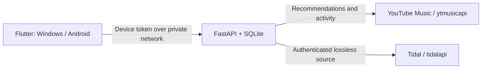

# Personal YouTube Music–Tidal Radio

YouTube Music recommendations, played through matching lossless recordings from Tidal. A personal radio player for **Windows and Android**, with a **Python/FastAPI server** you can host on Linux with Docker and reach through Tailscale.

Use your own YouTube Music and Tidal subscriptions. Provider credentials stay on your server; the players connect with a separate device token. This project uses unofficial integrations and is not affiliated with either service.

## What it does

- Search songs, artists and albums; browse artist releases and album track lists. Play songs or albums directly without starting radio.
- Add songs or whole albums to the queue, or play them next, while keeping the current radio context and recommendation order.
- **Autoplay:** start a song normally and follow YouTube's returned Automix recommendations.
- **Start radio:** explicitly start a song's radio mix, or choose a personalized station from your signed-in account.
- Preserve recommendation order and station context, prefetch tracks, and replenish saved queues across provider batches.
- Match recordings conservatively by identifiers and metadata, including duration, recording version and explicit status. Uncertain matches are skipped visibly; manual corrections are saved.
- Resolve music videos through YouTube's audio counterpart when supplied, or matching official-song metadata, so video introductions do not cause false duration mismatches. Review ambiguous Tidal candidates and retry skipped matches directly in the queue.
- Request Hi-Res lossless first, with standard lossless as the fallback. Proxy the original FLAC audio without lossy conversion, and display measured source quality when verification succeeds.
- Play, pause, seek, skip, like and dislike. Android includes background playback and media controls through `audio_service`.
- Like a song on both YouTube Music and Tidal. Each service has its own durable submission and status; clearing a Like removes it from both.
- Measure actual listening time and keep durable local totals, top songs and artist statistics. Eligible plays and explicit ratings are sent to YouTube on a best-effort basis, with uncertain results shown separately.

Autoplay and Start radio use different request paths. Independently created sessions can return different recommendations from the YouTube website, even for the same seed song.

## Downloads and status

[Download the Windows ZIP or Android APK](https://github.com/0withoutface0/youtube-tidal-radio/releases). These are early builds; each player needs a separately configured server and your own accounts.

Windows playback, full standard FLAC playback, full 24-bit source decoding, queue pagination and Docker restart persistence have been checked. Physical Android screen-off/headset/interruption behavior, continuous full Hi-Res playback on both devices, and prolonged network recovery still need acceptance testing. **YouTube Recap inclusion is unverified**, independently of successful history submission.

See [verification status](docs/VERIFICATION.md) and [remaining acceptance work](docs/RELEASE.md) for the limits of the current release. Highest available lossless describes the source; exclusive output and guaranteed bit-perfect hardware playback are outside this release.

## Start a local server

Requirements: Python 3.12+, [uv](https://docs.astral.sh/uv/getting-started/installation/), and FFmpeg/ffprobe on `PATH`.

```sh
git clone https://github.com/0withoutface0/youtube-tidal-radio.git
cd youtube-tidal-radio
uv sync --locked --extra dev
uv run radio-prototype serve
```

Open **http://127.0.0.1:8765** for account setup and diagnostics:

1. Connect YouTube using authenticated request headers, following the [ytmusicapi browser-auth instructions](https://ytmusicapi.readthedocs.io/en/stable/setup/browser.html). Paste them into the local setup page only.
2. Start Tidal login, open its sign-in link, then paste the final redirect URL into the local page. This uses the community library's [authenticated PKCE streaming support](https://github.com/EbbLabs/python-tidal/blob/main/examples/pkce_example.py).
3. Check song search, Autoplay, radio and stations. Verify full-length standard lossless and Hi-Res access with your account before relying on playback.
4. Start a player and enter the server origin and device token from `data/device-token.txt` in its Connection settings.

The local setup page is loopback-only by default. `data/` holds account sessions, the device token, SQLite records and local reports. It is excluded from Git and Docker's build context. Keep one server process/worker per database and back up this directory privately.

See [player setup and source builds](player/README.md) for Windows installation, Android sideloading, pairing, signing and Tailscale access. Once the local server environment and Windows build are prepared, `Start Personal Radio.cmd` launches both.

## Linux with Docker Compose

```sh
docker compose build
docker compose run --rm --entrypoint python radio -m radio_prototype auth youtube
docker compose run --rm --entrypoint python radio -m radio_prototype auth tidal
docker compose up -d
docker compose exec radio python -m radio_prototype status
```

Authentication is interactive in your own terminal. Compose publishes port 8765 to host loopback, disables browser account setup, and runs a non-root container with a read-only root filesystem. Its named volume retains accounts, matching corrections, listening history and pending submissions. Windows-local `data/` and the Docker volume are separate installations. Removing the volume removes those records.

For phone access, configure a private Tailscale HTTPS reverse proxy to `127.0.0.1:8765` and set `RADIO_ALLOWED_HOSTS` to that private hostname before starting Compose. Keep device-token authentication enabled. The [player guide](player/README.md) also covers a Windows server bound to its Tailscale IP. This project does not configure public ingress or Tailscale Funnel.

## Listening and reporting

Each queued occurrence and playback event has a stable UUID. Clients persist events before sending, so retries cannot duplicate local listening records. Pauses, buffering and seek jumps add no listening time. A skip does not become a dislike.

A history report becomes eligible after 30 seconds of actual listening, or natural completion of a shorter track with essentially all of it heard. A Like rates the original YouTube recommendation and favorites its matched Tidal recording. Clearing that Like removes both; changing a Like to Dislike also removes the Tidal favorite, while the dislike itself goes to YouTube. A standalone dislike leaves existing Tidal favorites alone. Pending, acknowledged, visible and uncertain submissions remain distinct for each provider; ambiguous writes are reconciled through reads and never blindly resubmitted. New explicit actions replace older unsent choices. Existing historical likes are not automatically copied between accounts.

YouTube history visibility does not prove that a particular repeat occurrence was counted. Official [Recap eligibility](https://support.google.com/youtubemusic/answer/11418178) for community-library reports remains unverified. Local listening statistics are retained regardless.

## Architecture and interfaces



The proxy supports direct FLAC byte ranges and supported static FLAC DASH manifests exposed as HLS without transcoding. Signed provider URLs stay on the server. Expired streams are renewed when their source identity remains compatible; unsupported manifests or changed sources fail visibly.

[Documented server interfaces](docs/API.md) cover account status, search, stations, queues, matching, streams, playback events, ratings and reports. The full [OpenAPI snapshot](docs/openapi.json) is included; a running server also exposes authenticated `GET /api/openapi.json`.

## Development

```sh
uv sync --locked --extra dev
uv run pytest -q
uv run ruff check radio_prototype tests
uv run ruff format --check radio_prototype tests
```

```sh
cd player
flutter pub get
flutter analyze
flutter test
```

Offline tests use temporary state and fixtures; they never submit activity to provider accounts. Decoder tests generate their own audio and require FFmpeg. Optional mpv checks run when mpv is available. The opt-in native integration test uses real accounts and is documented separately in the [player guide](player/README.md).

`uv.lock` pins the Python environment, `requirements.lock` pins and hashes Docker runtime dependencies, and `player/pubspec.lock` pins Flutter dependencies.

## Project license

No license has been granted for the project's own code. Third-party components retain their respective licenses; see [native notices](player/native-notices/SOURCES.md) and the app's Licenses screen.
